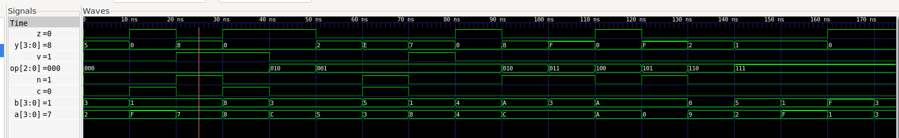

ALU (Verilog)

An N-bit ALU in Verilog with Z/N/C/V status flags, verified with iverilog testbench.

Implemented:
- 8 operations selected by a 3-bit opcode
- Width set by the WIDTH parameter
- Combinational (always @(*) with a case on the opcode)
- Zero, negative, carry/borrow and signed-overflow flags

Opcodes

000  ADD   y = a + b
001  SUB   y = a - b
010  AND   y = a & b
011  OR    y = a | b
100  XOR   y = a ^ b
101  NOT   y = ~a
110  SHL   y = a << 1
111  SLT   y = 1 if a < b (signed), else 0

Flags

Z is 1 when y is 0, for every operation.
N is the top bit of y, for every operation.
C is the carry-out for ADD and the borrow for SUB (x86 convention). It is 0 for all other operations.
V is set for ADD and SUB only, and is 0 for all other operations:
  ADD: V = (a[MSB] ~^ b[MSB]) & (a[MSB] ^ y[MSB])
  SUB: V = (a[MSB] ^ b[MSB]) & (a[MSB] ^ y[MSB])

Here. carry C is enabled for operations where bit length of the result exceeds the specified width, and overflow V is enabled when operations that have 2 numbers with the same sign result in a different sign. 

Files

alu/rtl/alu.v      design
alu/tb/tb_alu.v    testbench
alu/README.md

Run for testbench - 
    iverilog -Wall -o sim alu/rtl/alu.v alu/tb/tb_alu.v && vvp sim
    //runs the test
    verilator --lint-only -Wall alu/rtl/alu.v
    //lints RTL
    gtkwave alu.vcd
    //opens waveforms
=

Verification

The testbench worked by comparing each output to an expected value and counted the number of failures. edge cases were conducted for each operation including: carry, overflow, borrow, signed SLT, zeros, and default checks.
TODO: Add a waveform screenshot (docs/waveform.png).

Results

Directed tests: 18 / 18 passing
Lint: clean
Exhaustive test at 4 bits (cocotb): pending
Random test at 32 bits (cocotb): pending
Yosys cell count at WIDTH = 4 / 8 / 16: 
alu/synth/stat_w16.txt:   Number of cells:                485
alu/synth/stat_w4.txt:   Number of cells:                124
alu/synth/stat_w8.txt:   Number of cells:                243

Design decisions and trade-offs
- could have incorporated a shift right operation, since the NOT op can be executed through XOR'ing with all 1's.
- Writing a + b / a - b and letting synthesis decide adder, rather than building ripple/lookahead adders.

Bug story
- SLT compared unsigned until $signed() was caught
- put in the carry bit in subtraction as {y, c} instead of {c, y}.

Next steps

TODO: For example, SHR with a 4-bit opcode, registered inputs/outputs for timing, or running it through LibreLane.